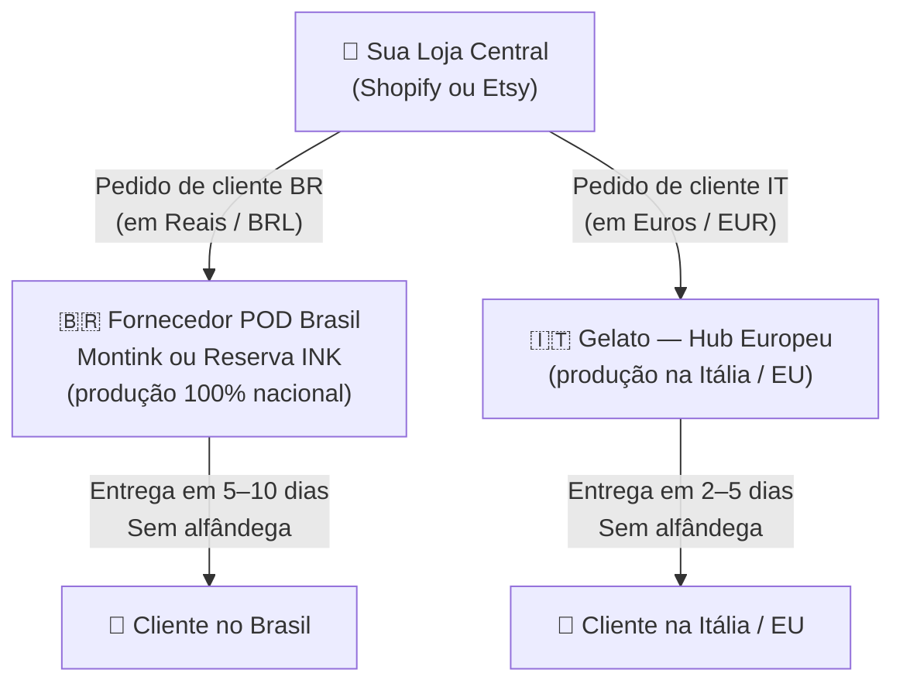
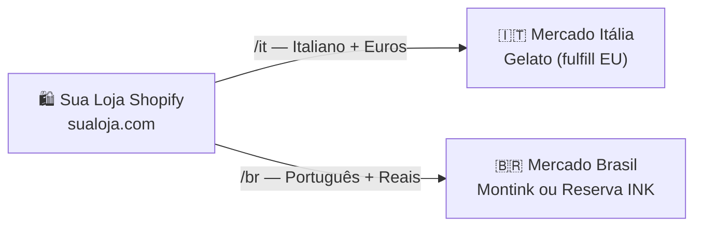

# 🇧🇷🇮🇹 Estratégia Completa: Vender Roupas POD no Brasil e na Itália

> [!IMPORTANT]
> Brasil e Itália são mercados **completamente diferentes** em moeda, idioma, logística e impostos. A chave do sucesso é usar **um fornecedor POD específico para cada país** e uma loja central que conecta tudo.

---

## 🏗️ A Arquitetura do Negócio (Visão Geral)



---

## 🔑 Por que usar dois fornecedores diferentes?

| | 🇧🇷 Brasil | 🇮🇹 Itália |
|---|---|---|
| **Fornecedor ideal** | Montink / Reserva INK | Gelato (hub EU) |
| **Moeda de cobrança** | R\$ (Reais) | € (Euro) |
| **Tempo de entrega** | 5–10 dias úteis | 2–5 dias úteis |
| **Risco de alfândega** | ❌ Nenhum (local) | ❌ Nenhum (local EU) |
| **Idioma da loja** | Português 🇧🇷 | Italiano 🇮🇹 |
| **IVA / Imposto** | ICMS incluso | VAT / IVA EU |

> [!TIP]
> Nunca envie do Brasil para a Itália nem vice-versa. A alfândega e o frete internacional destruiriam sua margem e a experiência do cliente.

---

## 🇧🇷 PARTE 1 — Como Vender no Brasil

### Melhores Fornecedores POD Brasileiros

| Fornecedor | Destaques | Integra com |
|---|---|---|
| **Montink** | + popular BR, catálogo amplo, fácil de usar | Shopify, Nuvemshop, loja própria |
| **Reserva INK** | App oficial na Shopify App Store, qualidade premium | Shopify |
| **HotPrinti** | Kits, produtos variados | Shopify, WooCommerce |
| **Uma Penca** | Boa qualidade, camisetas foco | Própria plataforma |

### Como configurar (Montink + Shopify — Recomendado)

```
1. Crie conta gratuita em montink.com
2. Crie seus produtos com suas estampas no painel Montink
3. Conecte ao Shopify via app oficial
4. O pedido chega → Montink produz e envia para o cliente BR
5. Você recebe: Preço de venda - Custo Montink = Lucro
```

### 💰 Precificação no Brasil (exemplo em R\$)

| Produto | Custo Montink | Frete BR | Seu preço | Margem |
|---|---|---|---|---|
| Camiseta basic | ~R\$25–35 | ~R\$15–25 | R\$79–99 | ~R\$30–40 |
| Moletom | ~R\$65–80 | ~R\$20–30 | R\$169–199 | ~R\$65–90 |

> [!WARNING]
> Sempre inclua o frete no cálculo da margem. Se oferecer "frete grátis", suba o preço do produto para compensar.

### Meios de Pagamento no Brasil

- **Mercado Pago** — aceita PIX, cartão, boleto (ideal para BR)
- **PagSeguro / Pagar.me** — robusto, aceita tudo
- **Stripe** — aceita cartão internacional

---

## 🇮🇹 PARTE 2 — Como Vender na Itália / Europa

### Por que o Gelato é perfeito para a Itália

- ✅ Tem **hub de produção dentro da Itália** e da EU
- ✅ Entrega em **2–5 dias** sem alfândega intra-EU
- ✅ Produtos populares europeus: **Stanley/Stella** (premium, sustentável), Bella+Canvas
- ✅ Integra nativamente com **Etsy** e **Shopify**

### Melhor plataforma de venda para Itália: **Etsy**

> [!NOTE]
> Para quem está começando a vender na Europa sem audiência própria, o **Etsy** é o caminho mais rápido. Ele já tem milhões de compradores europeus ativos, incluindo italianos que adoram comprar produtos de nicho, personalizados e com identidade.

#### Como montar sua loja no Etsy + Gelato (para Itália)

```
1. Crie conta no Etsy (etsy.com) — pode ser a partir do Brasil
2. Crie conta gratuita no Gelato (gelato.com)
3. Em Gelato: vá em "Stores" → conecte ao Etsy
4. Crie seus produtos no Gelato, escolhendo blanks europeus
5. Publique diretamente na sua loja Etsy
6. Pedido chega → Gelato produz no hub europeu → cliente recebe em 2–5 dias
```

### 💰 Precificação para a Itália (em €)

| Produto | Custo Gelato (EU) | Seu preço | Margem estimada |
|---|---|---|---|
| Camiseta Bella+Canvas | ~€8–12 | €28–35 | ~€15–20 |
| Camiseta Stanley/Stella | ~€12–16 | €35–45 | ~€18–25 |
| Moletom Gildan | ~€18–24 | €55–70 | ~€25–40 |

> [!TIP]
> **Estratégia de frete grátis:** Embuta o custo do frete (~€4–6) no preço do produto e ofereça "Envio Grátis" para a Itália/EU. O algoritmo do Etsy favorece lojas com frete grátis e o cliente converte muito mais.

### Impostos EU (VAT/IVA) — O que você precisa saber

> [!IMPORTANT]
> **Boa notícia:** Se você vender pelo **Etsy**, a própria plataforma coleta e repassa o IVA europeu automaticamente para pedidos abaixo de **€150** (regime IOSS). Você não precisa se registrar para IVA na EU para começar.

- Etsy gerencia o IOSS automaticamente ✅
- Gelato produz dentro da EU → sem importação → sem VAT de importação ✅
- Você só precisa declarar os lucros no seu imposto de renda brasileiro 📋

---

## 🛒 PARTE 3 — Uma Loja Para os Dois Países (Shopify)

Se você quiser uma **loja única com sua marca** atendendo os dois países, use o **Shopify + Shopify Markets**.

### Arquitetura no Shopify



### Configuração passo a passo no Shopify Markets

1. **Shopify Admin** → Configurações → **Markets**
2. Crie o **Mercado Brasil** → moeda BRL → idioma Português
3. Crie o **Mercado Itália/EU** → moeda EUR → idioma Italiano
4. Configure **perfis de frete separados** para cada mercado
5. Instale **Shopify Translate & Adapt** para traduzir para o Italiano
6. Conecte o Gelato para atender pedidos europeus e o Montink para pedidos brasileiros

> [!WARNING]
> O **Shopify Payments** (sistema nativo de pagamento) **não está disponível para lojas sediadas no Brasil**. Para receber em Euros de clientes italianos, use o **Stripe** (aceita internacionalmente e deposita na sua conta em BRL ou EUR).

### Gateways de Pagamento Recomendados

| Gateway | Brasil | Itália / EU | Observação |
|---|---|---|---|
| **Stripe** | ✅ | ✅ | Melhor para multimercado |
| **PayPal Business** | ✅ | ✅ | Muito confiável na Europa |
| **Mercado Pago** | ✅ | ❌ | Só Brasil (PIX, boleto) |

---

## 🌍 PARTE 4 — Estratégia de Conteúdo para os Dois Mercados

### Idioma e Canais

| | 🇧🇷 Brasil | 🇮🇹 Itália |
|---|---|---|
| **Idioma** | Português | Italiano (ou Inglês) |
| **Redes sociais** | Instagram, TikTok | Instagram, TikTok, Pinterest |
| **Marketplace** | Não obrigatório | **Etsy** (muito forte) |
| **Tendências** | Memes, humor, identidade BR | Arte, moda, identidade europeia |
| **Formato de vídeo** | Reels curtos / TikTok | Reels + Pinterest |

### Dicas de SEO no Etsy para a Itália

Palavras-chave em italiano que convertem bem:
- `maglietta personalizzata` (camiseta personalizada)
- `felpa stampata` (moletom estampado)
- `abbigliamento unico` (roupa única)
- `regalo originale` (presente original)
- `maglietta divertente` (camiseta engraçada)

---

## 📋 Passo a Passo — Do Zero às Primeiras Vendas

### ✅ Fase 1: Configuração (Semana 1–2)

- [ ] Crie conta no **Gelato** (gelato.com) — gratuito
- [ ] Crie conta no **Montink** (montink.com) — gratuito
- [ ] Crie loja no **Etsy** — para vender na Itália/EU primeiro (mais fácil)
- [ ] Conecte Gelato → Etsy
- [ ] Escolha o nicho da marca (único para os dois mercados)
- [ ] Crie 5–8 designs/estampas em **PNG 300dpi, fundo transparente**

### ✅ Fase 2: Produtos e Preços (Semana 2–3)

- [ ] No Gelato: crie produtos para **Itália/EU** com blanks europeus (Stanley/Stella, Bella+Canvas)
- [ ] No Montink: crie os mesmos produtos adaptados para **Brasil**
- [ ] Calcule os preços com margem real (veja tabelas acima)
- [ ] Peça **amostras físicas** nos dois países — teste antes de vender!
- [ ] Tire fotos/vídeos das amostras (conteúdo real vale ouro)

### ✅ Fase 3: Lançamento (Semana 3–4)

- [ ] Publique na loja Etsy (foco inicial: Itália/EU)
- [ ] Crie página no Instagram (Português + Inglês/Italiano)
- [ ] Comece com **conteúdo orgânico**: processo de criação, unboxing das amostras
- [ ] Adicione loja no **Montink** para vendas BR
- [ ] Configure Shopify com Shopify Markets (opcional nessa fase, escale depois)

### ✅ Fase 4: Crescimento (Mês 2+)

- [ ] Anuncie no Meta Ads para os dois mercados (segmente por país)
- [ ] Envie amostras para microinfluenciadores (BR e IT)
- [ ] Analise as métricas: qual mercado converte mais?
- [ ] Expanda para mais países da EU usando o mesmo Gelato

---

## ⚠️ Erros Críticos a Evitar

> [!CAUTION]
> Esses erros são comuns para quem tenta vender em dois países sem planejamento.

1. **Usar só o Gelato para o Brasil** — o catálogo de roupas local pode ser limitado e as margens em BRL são imprevisíveis com câmbio flutuante
2. **Enviar produto do Brasil para a Itália** — alfândega, frete caro e cliente insatisfeito = morte da loja
3. **Não ter preço em Euros na loja da EU** — cliente italiano não quer calcular câmbio
4. **Ignorar o IVA/VAT** — no Etsy é automático, mas confira sempre
5. **Usar o mesmo texto em português para vender na Itália** — tradução é obrigatória
6. **Não pedir amostras antes de vender** — qualidade varia entre hubs de produção

---

## 💡 Resumo Final — Qual Caminho Seguir

```
BRASIL: Montink (ou Reserva INK) + Shopify/Nuvemshop + Mercado Pago/PIX
ITÁLIA: Gelato (hub EU) + Etsy + Stripe/PayPal

LOJA ÚNICA (futuro): Shopify Markets + Gelato (IT) + Montink (BR) + Stripe
```

> [!TIP]
> **Comece pelo Etsy na Itália.** É a plataforma com menor barreira de entrada, audiência já formada e o Gelato integra perfeitamente. Em paralelo, use o Montink para vender no Brasil via redes sociais. Quando tiver faturamento consistente nos dois, migre tudo para uma loja Shopify única com os dois mercados.
