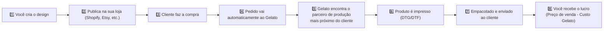

# 👕 Guia Completo: Abrir sua Marca de Roupa com Gelato (POD)
## 🇧🇷🇮🇹 Estratégia Dupla: Vendendo no Brasil e na Itália

> [!NOTE]
> Este guia foca em usar o **Gelato** como plataforma POD global, com observações importantes para quem vende para o **Brasil** ou para mercados internacionais.

---

## 🧠 O que é Print on Demand (POD)?

**Print on Demand** é um modelo de negócio onde:

- Você cria os designs/estampas
- Publica os produtos na sua loja
- **Só paga pela produção após a venda acontecer**
- O fornecedor (Gelato) fabrica, embala e envia diretamente ao seu cliente

**Nenhum estoque. Nenhum risco financeiro inicial. Foco total em design e marketing.**

---

## 🍦 O que é o Gelato?

O Gelato é uma das maiores plataformas globais de POD, operando em mais de **32 países** com uma rede descentralizada de parceiros de produção locais. Isso o diferencia de concorrentes como Printful e Printify:

| Característica | Gelato | Printful | Printify |
|---|---|---|---|
| Rede de produção | Local (32+ países) | Centralizada (EUA/Europa) | Rede de parceiros |
| Plano gratuito | ✅ Sim | ✅ Sim | ✅ Sim |
| Presença no Brasil | ✅ Sim | ⚠️ Parcial | ⚠️ Parcial |
| Frete internacional | Mais barato (produz localmente) | Mais caro | Médio |
| Foco principal | Arte, papelaria + roupas | Roupas + acessórios | Roupas + acessórios |

---

## ⚙️ Como Funciona o Gelato — O Fluxo Completo



---

## 👗 Catálogo de Roupas do Gelato

### Tipos de Produtos Disponíveis

| Categoria | Exemplos |
|---|---|
| **Camisetas** | Bella+Canvas 3001, Gildan 64000, V-neck, tank tops |
| **Moletons & Moletom** | Gildan 18500 pullover, zip-up hoodies, crewneck |
| **Infantil & Baby** | Bodies, camisetas kids, hoodies juvenis |
| **Activewear** | Polos, cortes atléticos masculino e feminino |
| **Feminino** | Camisetas fitted, blusas |

### Marcas de Blanks (Base) Disponíveis

- 🥇 **Bella+Canvas** — premium, toque macio, muito popular nos EUA
- **Gildan** — custo-benefício, boa para iniciantes
- **Stanley/Stella** — foco em sustentabilidade (GOTS, orgânico)
- **Lane Seven** — streetwear, tecidos mais pesados
- **Allmade** — sustentável, misto de algodão reciclado
- **SOL'S** — forte presença europeia

### Tecnologia de Impressão

- **DTG (Direct-to-Garment):** Impressão direta na malha. Excelente para designs com muitas cores e gradientes. Requer cuidado na lavagem.
- **DTF (Direct-to-Film):** Transferência de filme. Mais durável, cores mais vivas, funciona em mais tipos de tecido.
- **Bordado (Embroidery):** Disponível em hubs selecionados (verificar disponibilidade para o Brasil).

---

## 💰 Preços, Custos e Margens

### Estrutura de Custos

> [!IMPORTANT]
> Você só paga ao Gelato **depois** que o cliente pagar na sua loja. Não há custo antecipado.

**Custos estimados (em USD):**

| Produto | Custo Base (Plano Free) | Custo Base (Gelato+) | Preço Sugerido de Venda | Margem Estimada |
|---|---|---|---|---|
| Camiseta Bella+Canvas 3001 | ~\$7–\$11 | ~\$5–\$8 | \$24–\$30 | ~\$13–\$18 |
| Moletom Gildan 18500 | ~\$16–\$22 | ~\$12–\$16 | \$44–\$55 | ~\$20–\$30 |
| Body infantil | ~\$9–\$13 | ~\$7–\$10 | \$20–\$28 | ~\$10–\$16 |

> [!WARNING]
> Se você vende em **Reais (BRL)** para o Brasil, precisa calcular a conversão cambial + taxas do gateway de pagamento na sua margem. Exemplo: se o custo é \$10 USD + \$4 frete = \$14 USD ≈ R\$84 (câmbio de ~R\$6). Venda a R\$150–R\$180 para ter margem saudável.

### Frete

- **EUA:** \$3,99–\$5,00 para a primeira camiseta
- **Europa:** Geralmente local e rápido (produz dentro do continente)
- **Brasil:** Depende do parceiro local. Verifique no painel antes de lançar

---

## 📋 Planos do Gelato

| Plano | Preço | Benefícios |
|---|---|---|
| **Free (Gratuito)** | \$0/mês | Acesso ao catálogo, integrações básicas, mockups padrão |
| **Gelato+** | ~\$24/mês (ou ~\$19/mês anual) | Até **30–33% de desconto** nos produtos, mockups premium, Personalization Studio, ferramentas de design |
| **Gelato+ Gold** | ~\$99/mês | Descontos ainda maiores, suporte prioritário, recursos avançados de automação |

> [!TIP]
> Comece com o plano **gratuito** para validar o negócio. Migre para o Gelato+ quando as vendas cobrirem o custo da assinatura (geralmente a partir de 10–15 pedidos/mês).

---

## 🔌 Integrações de Loja

O Gelato se conecta nativamente com:

| Plataforma | Ideal para |
|---|---|
| **Shopify** | Sua própria loja profissional (melhor opção para marca própria) |
| **Etsy** | Marketplace com público comprador já formado (ótimo para começar) |
| **WooCommerce** | WordPress + e-commerce |
| **Wix** | Construtor de sites com e-commerce integrado |
| **Squarespace** | Foco em design visual |

---

## 🇧🇷 Gelato no Brasil — O que você PRECISA saber

> [!IMPORTANT]
> O Gelato **tem parceiros de produção no Brasil**, mas o catálogo de roupas disponível para produção local pode ser mais limitado do que o catálogo dos EUA/Europa.

**Cenários possíveis ao vender para clientes no Brasil:**

1. **Produto produzido localmente (Brasil):** Mais rápido, sem alfândega, frete mais barato ✅
2. **Produto importado (EUA ou Europa):** Prazo maior, risco de taxação na alfândega ⚠️

**Ação obrigatória antes de lançar:** Entre no painel do Gelato → Catálogo de Produtos → filtre por "Available for Brazil" para ver o que realmente é produzido aqui.

**Alternativas 100% brasileiras ao Gelato para o mercado BR:**
- **Reserva INK** — grande catálogo, foco no mercado BR
- **Montink** — muito popular, integra com Shopify e Nuvemshop
- **HotPrinti** — forte em kits e produtos variados
- **Uma Penca** — boa qualidade, foco em camisetas

---

## 🚀 Passo a Passo: Como Abrir sua Marca

### Fase 1 — Fundação (Semana 1–2)

- [ ] **Definir o nicho da marca** — Não venda "para todo mundo". Ex: humor de profissões, streetwear minimalista, cultura nerd/geek, memes regionais, natureza/outdoors, esporte específico
- [ ] **Criar o nome e identidade visual** — Logo, paleta de cores, tipografia. Ferramentas: Canva (gratuito), Adobe Express, Looka (IA para logos)
- [ ] **Criar conta gratuita no Gelato** → [gelato.com](https://gelato.com)
- [ ] **Definir plataforma de loja** — Shopify (melhor para marca própria) ou começar pelo Etsy (marketplace com tráfego orgânico)

### Fase 2 — Criação (Semana 2–3)

- [ ] **Criar os designs/estampas** — Ferramentas: Adobe Illustrator, Canva Pro, Kittl, Procreate (iPad)
- [ ] **Especificações técnicas para upload no Gelato:**
  - Formato: **PNG com fundo transparente**
  - Resolução: **mínimo 150 DPI, ideal 300 DPI**
  - Modo de cor: **RGB** (não CMYK para DTG)
  - Área de impressão: respeitar as dimensões indicadas para cada produto
- [ ] **Criar os produtos no Gelato** — Escolher a peça, fazer upload do design, ajustar posicionamento no editor
- [ ] **Gerar mockups realistas** — Use o gerador de mockups do próprio Gelato ou ferramentas externas (Placeit, Smartmockups)

### Fase 3 — Loja e Preços (Semana 3–4)

- [ ] **Conectar Gelato à loja** (Shopify, Etsy, etc.)
- [ ] **Calcular e definir preços de venda:**
  - Fórmula: `Custo Gelato + Frete estimado + Margem desejada (40–60%) = Preço de venda`
- [ ] **Escrever descrições de produto** que vendam (não apenas descrevam)
- [ ] **Pedir amostras (Sample Orders)** — Gelato oferece desconto para amostras. TESTE ANTES de vender ao público!
- [ ] **Configurar meios de pagamento** na loja

### Fase 4 — Lançamento e Marketing

- [ ] **Criar perfis nas redes sociais** (Instagram, TikTok, Pinterest)
- [ ] **Produzir conteúdo de lançamento** — Vídeos vestindo as peças, bastidores da criação, história da marca
- [ ] **Estratégia de lançamento em "Drops"** — Lançar coleções limitadas gera urgência
- [ ] **Microinfluenciadores** — Enviar peças para criadores do seu nicho (5k–50k seguidores = alto engajamento)
- [ ] **Primeiros anúncios pagos** — Meta Ads (Instagram/Facebook) segmentado para o nicho

---

## 🎨 Branding — O Segredo para Cobrar Mais

> [!IMPORTANT]
> No POD, o produto físico é o mesmo que qualquer concorrente pode ter. **O que diferencia sua marca é o branding.**

### Os 5 Pilares do Branding para Marcas POD

1. **Nicho & Conceito** — Sua marca tem uma "tribo"? Um conjunto de pessoas que se identificam com a mensagem?
2. **Identidade Visual** — Logo, cores, fontes devem ser consistentes em tudo
3. **Tom de Voz** — Como você fala com sua audiência? Engraçado? Inspirador? Técnico?
4. **Storytelling** — Conte a história da marca. Por que ela existe? Qual dor ou desejo ela resolve?
5. **Experiência de Unboxing** — Mesmo em POD, você pode configurar etiquetas personalizadas e embalagens com sua marca no Gelato (recurso premium)

---

## 📊 Métricas para Monitorar

| Métrica | O que medir |
|---|---|
| **Taxa de conversão da loja** | % de visitantes que compram (meta: 1–3%) |
| **CAC (Custo de Aquisição de Cliente)** | Quanto gasta em marketing por cliente |
| **Margem líquida por produto** | Lucro real após todos os custos |
| **Ticket médio** | Valor médio de compra (incentive kits e combos) |
| **Taxa de recompra** | % de clientes que voltam a comprar |

---

## ⚠️ Erros Comuns para Evitar

> [!CAUTION]
> Estes erros são os mais comuns e podem custar tempo e dinheiro.

1. **Não testar amostras antes de vender** — A qualidade da impressão pode variar. Teste SEMPRE.
2. **Designs com baixa resolução** — Resultado pixelado e profissional arruinado.
3. **Não calcular o frete no preço** — O cliente paga frete no checkout: calcule isso na sua margem.
4. **Lançar 50 produtos de uma vez** — Comece com 5–10 produtos focados. Qualidade > quantidade.
5. **Copiar designs com copyright** — Personagens, logos e músicas protegidos = processo e banimento.
6. **Ignorar o mercado alvo** — Gelato é ideal para EUA/Europa. Para vender só no Brasil, considere alternativas locais como Montink ou Reserva INK.
7. **Esperar perfeição para lançar** — Lance, colete feedback, melhore. Feito é melhor que perfeito.

---

## 🛠️ Ferramentas Essenciais para sua Marca POD

| Ferramenta | Uso | Plano gratuito? |
|---|---|---|
| **Gelato** | Produção e fulfillment | ✅ |
| **Shopify** | Loja virtual | 14 dias grátis |
| **Etsy** | Marketplace | ✅ (taxa por venda) |
| **Canva Pro** | Criação de designs e mockups | ✅ (limitado) |
| **Kittl** | Designs estilo tipografia e vintage | ✅ (limitado) |
| **Placeit** | Mockups fotorrealistas | ✅ (limitado) |
| **Looka** | Criação de logo com IA | Pago |
| **Meta Ads** | Anúncios no Instagram/Facebook | Pago por uso |

---

## 💡 Resumo Executivo — Sua Rota para a Primeira Venda

```
1. Escolha um nicho específico
2. Crie 5–10 designs focados nesse nicho
3. Abra conta gratuita no Gelato + conecte ao Shopify ou Etsy
4. Configure os produtos com preços com margem saudável
5. Peça amostras e documente tudo (fotos/vídeos reais)
6. Lance com conteúdo orgânico no Instagram e TikTok
7. Escale com anúncios pagos o que já funciona organicamente
```

> [!TIP]
> A sua primeira venda vai acontecer mais rápido do que você imagina quando você tem um nicho claro, designs de qualidade e conteúdo consistente nas redes sociais. **Consistência > Perfeição.**
