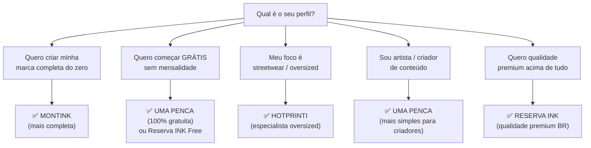

# 🇧🇷 POD no Brasil — Empresas, Valores e Opções Completas

> [!NOTE]
> Todos os valores são aproximados e podem variar. Sempre confirme os preços atuais no site de cada plataforma antes de precificar seus produtos.

---

## 🏆 Comparativo Rápido das 5 Principais Empresas

| Empresa | Plano Gratuito | Mensalidade | Custo Camiseta Base | Integra com Shopify | Ideal para |
|---|---|---|---|---|---|
| **Montink** | ❌ (7 dias trial) | R\$149–199/mês | R\$41–48 | ✅ | Marca própria completa |
| **Reserva INK** | ✅ (limitado) | R\$0–1.899/mês | R\$44–59 | ✅ | Qualidade premium |
| **HotPrinti** | ✅ | Gratuito/Pago | R\$27–85 | ✅ | Streetwear, oversized |
| **Uma Penca** | ✅ | Gratuito | R\$60–90 (PVP) | ❌ (loja própria deles) | Artistas/criadores |
| **Dimona** | ✅ | Gratuito | R\$35–80 | ⚠️ Via integração | Qualidade + variedade |

---

## 1️⃣ Montink — A mais completa para marca própria

> **Site:** [montink.com](https://montink.com)

### Planos e Preços

| Plano | Valor Mensal | Valor Anual (por mês) |
|---|---|---|
| **Essencial** | R\$149/mês | ~R\$127/mês |
| **Escalada** | R\$199/mês | ~R\$169/mês |

> [!TIP]
> O plano anual tem desconto significativo. Se já decidiu que vai seguir com a Montink, vale optar pelo anual.

### Catálogo de Produtos e Custos de Base

| Produto | Custo de base (R\$) | Preço sugerido de venda | Margem estimada |
|---|---|---|---|
| Camiseta Traditional (algodão) | R\$41–48 | R\$89–119 | R\$40–70 |
| Camiseta Estonada / Prime | R\$59–64 | R\$119–149 | R\$50–80 |
| Camiseta Oversized / Tech | R\$96–109 | R\$179–219 | R\$70–110 |
| Camiseta Pima (premium) | ~R\$119 | R\$199–249 | R\$70–120 |
| Croppped | ~R\$48 | R\$99–129 | R\$45–75 |
| Moletom canguru | R\$143–161 | R\$269–329 | R\$100–160 |
| Caneca | ~R\$31 | R\$69–89 | R\$35–55 |
| Ecobag | ~R\$25 | R\$59–79 | R\$30–50 |

### Integrações disponíveis
- Shopify ✅
- Nuvemshop ✅
- Loja própria na Montink ✅
- WooCommerce ✅

### ✅ Vantagens
- Plataforma mais robusta e completa do BR
- Loja virtual própria inclusa no plano
- Suporte em português
- Amplo catálogo de produtos

### ❌ Desvantagens
- Não tem plano gratuito permanente
- Mensalidade obrigatória para usar

---

## 2️⃣ Reserva INK — A mais premium em qualidade

> **Site:** [reserva.ink](https://reserva.ink)

### Planos e Preços

| Plano | Valor Mensal | Custo da camiseta base | Para quem é |
|---|---|---|---|
| **Gratuito** | R\$0 | ~R\$59 | Iniciante / validação (limite de ~10 peças/mês) |
| **Essencial** | ~R\$159/mês | ~R\$59 | Quem está estruturando o negócio |
| **Impulso** | ~R\$799/mês | ~R\$46 | Volume médio-alto de pedidos |
| **Escala** | ~R\$1.899/mês | ~R\$44 | Marcas consolidadas, alto volume |

> [!IMPORTANT]
> O modelo da Reserva INK é baseado em **quanto mais você paga de plano, menor fica o custo de produção por peça**, aumentando sua margem. Faz sentido ir subindo de plano conforme as vendas crescem.

### Catálogo de Produtos

- Camisetas 100% algodão 30.1 penteado
- Camisetas oversized, croppeds, regatas
- Algodão peruano (linha premium)
- Moletons com e sem capuz
- Vestuário infantil e bodies de bebê
- Cores: branco, preto, cinza mescla, azul-marinho, verde, vermelho, amarelo, rosa

### Integrações disponíveis
- Shopify ✅ (app oficial na Shopify App Store)
- Nuvemshop ✅

### ✅ Vantagens
- Tem plano **100% gratuito** para começar e validar
- Qualidade premium (marca Reserva por trás)
- App oficial na Shopify App Store
- Escalabilidade de planos conforme o crescimento

### ❌ Desvantagens
- Plano gratuito muito limitado (~10 peças/mês)
- Planos mais avançados são caros (R\$799–R\$1.899)
- Catálogo menor que a Montink

---

## 3️⃣ HotPrinti — A melhor para streetwear e oversized

> **Site:** [hotprinti.com.br](https://hotprinti.com.br)

### Planos
- **Plano Gratuito** disponível ✅
- Planos pagos com recursos avançados (verificar site para valores atuais)

### Catálogo de Produtos e Custos de Base

| Produto | Custo de base (R\$) |
|---|---|
| Regata / Infantil | R\$20–30 |
| Camiseta Traditional (fio 30.1) | R\$27–38 |
| **Camiseta Oversized Heavy Boxy** | R\$44–65 |
| **Camiseta Super Oversized** | R\$65–85 |
| Camiseta Suedine | R\$44–55 |
| Moletom Careca | ~R\$60 |
| **Moletom Canguru (2 cabos)** | R\$73–90 |
| **Moletom Canguru (3 cabos / premium)** | R\$90–109 |

### Integrações disponíveis
- Shopify ✅
- Loja virtual própria ✅
- WooCommerce ✅

### ✅ Vantagens
- **Especialista em oversized e streetwear** (diferencial grande)
- Plano gratuito disponível
- Preços competitivos
- Ótimo para marcas de moda urbana

### ❌ Desvantagens
- Menor reconhecimento de marca vs Montink/Reserva INK
- Catálogo menor em diversidade de produtos não-vestuário

---

## 4️⃣ Uma Penca — Para artistas e criadores de conteúdo

> **Site:** [umapenca.com](https://umapenca.com)

### Planos
- **100% Gratuito** ✅ — você cria sua lojinha dentro da plataforma deles

### Como funciona
- Você cria uma loja **dentro do ecossistema da Uma Penca**
- Define sua margem de lucro em cima do preço base deles
- Eles produzem, embalam e enviam
- Você recebe o lucro automaticamente

### Faixa de preços ao consumidor final (já com sua margem)
| Produto | Faixa de preço final |
|---|---|
| Camisetas | R\$60–90 |
| Moletons canguru | R\$150–240 |

### ✅ Vantagens
- **Totalmente gratuita** — zero mensalidade
- Perfeita para artistas e criadores independentes
- Simples de usar, zero configuração técnica
- Você foca apenas em criar designs e divulgar

### ❌ Desvantagens
- Sua loja fica **dentro do site deles** (não é sua loja própria com domínio próprio)
- Não integra com Shopify
- Menos controle sobre branding e experiência do cliente
- Menor flexibilidade de personalização da loja

---

## 5️⃣ Dimona — A tradicional, qualidade e variedade

> **Site:** [camisadimona.com.br](https://camisadimona.com.br)

### Planos
- Gratuito para pedidos avulsos/dropshipping ✅

### Catálogo de Produtos e Custos de Base

| Produto | Custo de base (R\$) | Técnica de impressão |
|---|---|---|
| Camiseta algodão (vários tipos) | R\$35–80 | DTF, Silk Digital, Sublimação |
| Moletom Quality (260g/m²) | R\$80–120 | DTF, Silk |
| Moletom Prime (310g/m²) | R\$100–150 | DTF, Silk |

### Integrações disponíveis
- Via Dropsimples (integração de dropshipping) ✅
- WooCommerce ⚠️ (via parceiros)

### ✅ Vantagens
- Empresa **muito tradicional e confiável** no mercado BR
- Maior variedade de **técnicas de impressão** (DTF, silk, bordado, sublimação)
- Excelente qualidade de malha
- Boa para quem quer qualidade artesanal/premium

### ❌ Desvantagens
- Menos automatizado que Montink/Reserva INK
- Integração com e-commerce menos plug-and-play
- Foco maior em estamparia do que em plataforma de marca completa

---

## 📊 Qual escolher? Recomendação por Perfil

---

## 💰 Simulação de Lucro Real (por produto vendido)

Exemplo usando **camiseta básica** nos três principais fornecedores:

| | Montink | Reserva INK (Essencial) | HotPrinti |
|---|---|---|---|
| Custo de produção | R\$45 | R\$59 | R\$32 |
| Frete ao cliente | ~R\$20 | ~R\$20 | ~R\$18 |
| Seu preço de venda | R\$99 | R\$99 | R\$89 |
| **Lucro por peça** | **~R\$34** | **~R\$20** | **~R\$39** |
| Mensalidade (proporcional) | -R\$5 | -R\$5 | R\$0 |
| **Lucro líquido real** | **~R\$29** | **~R\$15** | **~R\$39** |

> [!WARNING]
> Esses valores são estimativas. Descontos no frete (frete grátis ao cliente), taxas da plataforma de pagamento (~2–3%) e custos de marketing precisam ser descontados do lucro real.

---

## 🛒 Plataformas de Loja Virtual para BR

| Plataforma | Custo | Melhor para |
|---|---|---|
| **Montink** (loja própria) | Inclusa no plano | Quem usa a Montink |
| **Nuvemshop** | R\$0–299/mês | Loja BR focada, fácil de usar |
| **Shopify** | ~R\$140–400/mês | Escalabilidade e apps avançados |
| **WooCommerce** | Gratuito (hospedagem paga) | Quem sabe mexer com WordPress |
| **Instagram/WhatsApp** | Gratuito | Para começar sem loja (link na bio) |

---

## ✅ Recomendação Final para Começar HOJE

> [!TIP]
> **Caminho mais rápido e barato para a primeira venda no Brasil:**
>
> 1. **Crie conta gratuita na Reserva INK** → valide seus designs sem gastar nada (limite de ~10 peças/mês)
> 2. **Divulgue no Instagram e TikTok** → venda pelas DMs + link na bio
> 3. **Quando bater 10+ pedidos/mês** → migre para o plano pago da Montink (mais completo) ou suba de plano na Reserva INK
> 4. **Com renda consistente** → monte loja na Nuvemshop ou Shopify com domínio próprio
